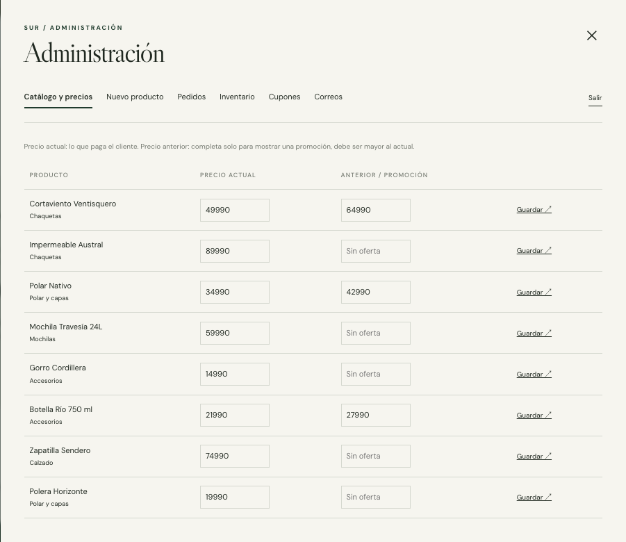
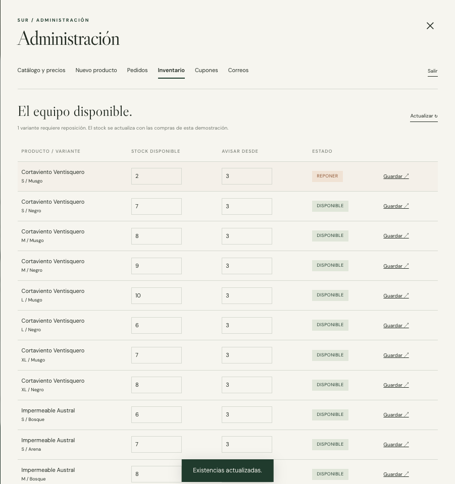
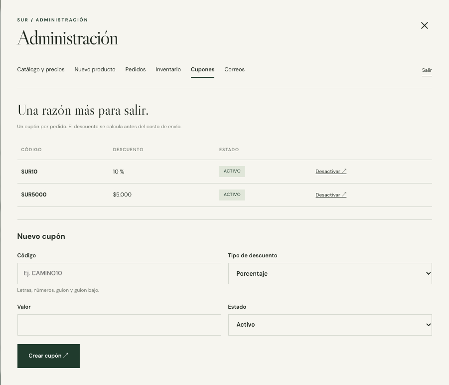
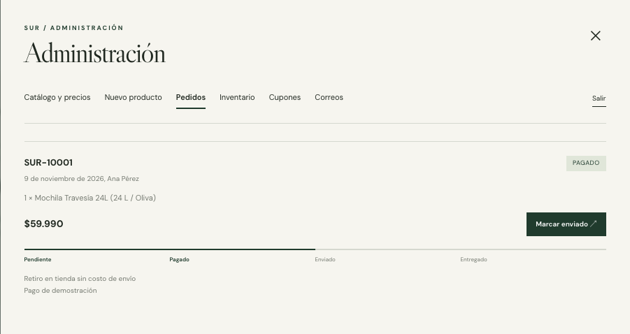
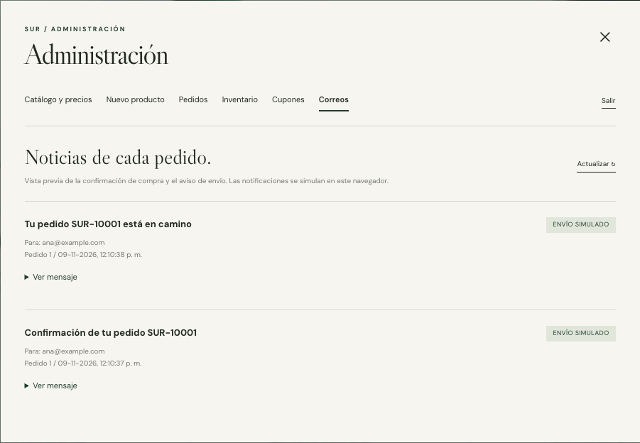

# Manual de Administración de SUR

ShopLite es una demostración frontend. Las compras, los pagos y las notificaciones se simulan y los cambios se conservan en el navegador utilizado. Las capturas muestran datos ficticios.

## Entrar y salir

Abre la tienda y selecciona **Administración** al final de la página. Ingresa la clave `12345678`. Verás las secciones Catálogo y precios, Nuevo producto, Pedidos, Inventario, Cupones y Correos.

El botón **Salir** vuelve a la pantalla de ingreso. Cerrar el diálogo conserva el acceso durante la sesión del navegador. La clave representa el flujo del mockup y está incluida en el código público.



## Cambiar precios y promociones

1. En **Catálogo y precios**, busca el producto.
2. Cambia el precio actual en pesos chilenos, sin puntos ni decimales. Por ejemplo, `45990` representa $45.990.
3. Para mostrar una promoción, completa el precio anterior con un valor mayor al actual. Deja ese campo vacío para quitar la promoción.
4. Selecciona **Guardar** en la fila. El catálogo y el carrito mostrarán el nuevo precio.

Un pedido ya creado conserva los precios y el total que tenía al confirmarse su creación.

## Agregar un producto

Selecciona **Nuevo producto** y completa nombre, categoría, descripción y precio. El precio anterior es opcional. Indica entre una y ocho direcciones de imágenes, una por línea: pueden ser HTTPS o archivos existentes de `./imagenes/`.

Para probar con una imagen incluida en la demostración puedes usar:

```text
./imagenes/photo-1553062407-98eeb64c6a62.webp
```

Escribe cada variante en una línea con el formato **talla, color, stock**:

```text
S, Verde bosque, 5
M, Verde bosque, 8
L, Arena, 3
```

Usa `Única` para productos sin talla y un stock entero igual o mayor a cero. Selecciona **Publicar producto**. Aparecerá en la tienda de este navegador; no se modifica el catálogo de los demás visitantes.

## Controlar inventario

En **Inventario** cada fila representa una combinación de talla y color. Cambia **Stock disponible** y **Avisar desde**, y selecciona **Guardar**.

- **Reponer** aparece cuando el stock es igual o inferior al umbral.
- Un stock de cero impide agregar esa variante a la bolsa.
- El pago aprobado descuenta unidades una sola vez. Un rechazo conserva el stock.



## Crear y activar cupones

En **Cupones**, completa código, tipo, valor y estado. Los códigos admiten letras, números, guion y guion bajo. No se puede repetir un código existente.

| Tipo | Ejemplo | Resultado |
| --- | --- | --- |
| Porcentaje | `CAMINO15`, valor `15` | Descuenta el 15 % del subtotal. |
| Monto fijo | `SALIDA5000`, valor `5000` | Descuenta hasta $5.000 del subtotal. |

Selecciona **Crear cupón**. Puedes **Activar** o **Desactivar** un cupón desde su fila. La tienda incluye `SUR10` y `SUR5000` para la presentación. Se aplica un solo cupón por compra y el descuento nunca supera el subtotal.

El envío gratuito se calcula después del descuento: desde $80.000. El retiro es gratuito; el despacho cuesta $3.990 en la Región Metropolitana y $6.990 en las demás regiones cuando no se cumple el mínimo.



## Revisar y avanzar pedidos

La sección **Pedidos** muestra productos, total, entrega y seguimiento. Para crear un pedido, compra desde la tienda y elige el resultado del pago simulado en el checkout.

| Estado | Acción disponible |
| --- | --- |
| Pendiente | El comprador puede retomar el pago desde Mis pedidos. |
| Pagado | Administración puede seleccionar **Marcar enviado**. |
| Enviado | Administración puede seleccionar **Marcar entregado**. |
| Entregado | El seguimiento está completado. |

Los estados avanzan en ese orden. Administración no convierte directamente un pedido pendiente en pagado. Si el pago se rechaza, el comprador puede reintentar en la misma vista o retomarlo después; se conserva el mismo número de pedido, los datos de entrega y el total original. La entrega y el cupón quedan bloqueados después de crear el pedido; el resultado del pago sigue editable.



## Ver las notificaciones

En **Correos** aparecen vistas previas de la confirmación al aprobar un pago y del aviso al marcar el pedido como enviado. Selecciona **Ver mensaje** para leer el contenido. La etiqueta **Envío simulado** indica que el registro pertenece al mockup; no se envía correo real.



## Conservar o reiniciar la demostración

Recargar la página conserva productos, precios, stock, cupones, pedidos, reseñas y favoritos en ese navegador. Otro perfil, equipo o dirección tiene datos independientes. Para volver al catálogo inicial, borra los datos del sitio desde los ajustes del navegador y recarga.

El acceso administrativo utiliza `sessionStorage`; los datos de la tienda utilizan `localStorage`. Si el navegador bloquea el almacenamiento o se queda sin espacio, la página muestra el error y conserva el estado anterior a la operación fallida.
